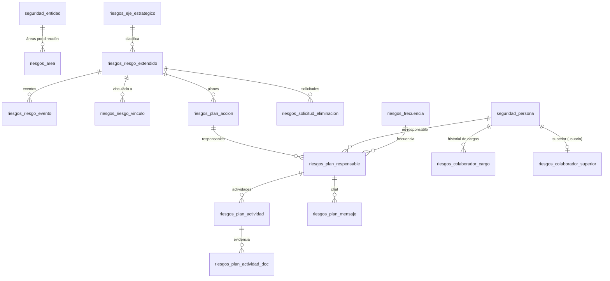

# MARN: diseño del modelo de datos

Rama: `MARN` · Fecha: 2026-11-26 · Se basa en [01-decisiones.md](01-decisiones.md).

## Convenciones

- Base `gestion_riesgos`, MariaDB/MySQL, `utf8mb4`.
- **ORM: Prisma con `@prisma/adapter-mariadb`** (se trae la rama `cambio-orm` y se quita sequelize). Todo cambio de esquema va como **migración de Prisma** en `backend/prisma/migrations/`. Desde 2026-11-27 todo el backend usa Prisma: los controladores nuevos con el cliente tipado y los anteriores con SQL parametrizado vía `backend/bd/consultas.js`; `mysql2` se retiró.
- La bitácora `riesgos_logs` se llena con **triggers** `trg_<tabla>_insert|update|delete`. Prisma no los modela, así que cada tabla nueva lleva sus triggers en SQL dentro de su migración.
- Las tablas nuevas usan el prefijo `riesgos_` y llevan `CODIGO_CIA` en todas las llaves, como el resto del esquema.
- **Las tablas nuevas tienen llave `AUTO_INCREMENT`** (`CODIGO_*`) más `CODIGO_CIA`. Las existentes calculan el código con `MAX()+1`, lo que puede chocar si dos usuarios guardan al mismo tiempo; no se cambian ahora.
- Auditoría en todas las tablas nuevas: `USUARIO_CREACION`, `FECHA_CREACION`, `USUARIO_MODIFICACION`, `FECHA_MODIFICACION` (se omiten abajo), y registro en `riesgos_logs` como hoy.
- Llave del riesgo (se repite abajo como **«riesgo»**): `CODIGO_CIA, CODIGO_ENTIDAD, CODIGO_PERIODO, CODIGO_RIESGO` → `riesgos_riesgo_extendido`.
- Persona/usuario: `CODIGO_CIA, CODIGO_COLABORADOR` → `seguridad_persona`.
- Los borrados son lógicos (`ACTIVO` / `ELIMINADO`).

## Vista general

Flujo de ejecución: **riesgo aprobado (jefe → superior) → planes → responsables → actividades → verificación del superior del responsable.**

---

## 1. Cambios a tablas existentes

### 1.1 `riesgos_area`: áreas por dirección (decisión 1)

| Columna nueva | Tipo | Nota |
|---|---|---|
| `CODIGO_ENTIDAD` | int NULL, FK `seguridad_entidad` | Dirección dueña del área. `NULL` = área general (como hoy), para no romper datos de otros clientes. |

- Índice `(CODIGO_CIA, CODIGO_ENTIDAD)`.
- Al crear o editar un riesgo, el selector de área muestra las áreas de la dirección más las generales.
- MARN: todas sus áreas llevan `CODIGO_ENTIDAD`.

### 1.2 `riesgos_riesgo_extendido`

| Columna nueva | Tipo | Decisión | Nota |
|---|---|---|---|
| `OBJETIVO_TEXTO` | varchar(800) NULL | 4 | Objetivo específico escrito libremente. El **catálogo histórico** es `SELECT DISTINCT OBJETIVO_TEXTO` de la institución (autocompletar). `CODIGO_OBJETIVO` se conserva para los datos actuales. |
| `CODIGO_EJE` | int NULL, FK `riesgos_eje_estrategico` | 5 | Visible solo si la versión de propiedades del periodo incluye la propiedad `CODIGO_EJE`. |
| `EFICIENCIA_MITIGADOR` | int NULL, FK `riesgos_mitigacion` | P1 | Informativo; no entra en el cálculo. Solo lo llena la migración de MARN. |
| `CODIGO_DUENO` | int NULL, FK persona | 13, P3 | Responsable visible del riesgo. Por defecto, quien lo crea. No da permisos extra. |

- `EVENTO` **se mantiene** y la aplicación lo llena con la lista de eventos (uno por línea), para que la matriz del Anexo IV y los reportes actuales sigan funcionando.
- `CONTROL` y `MONITOREO` se quedan como texto (decisión 8).
- `RESPONSABLE` y `CODIGO_FRECUENCIA` del riesgo se quedan para la matriz de continuidad (Anexo V). Los responsables operativos están en los planes.

### 1.3 `riesgos_colaborador_superior`: el superior pasa a ser usuario (P2, diseño 1)

| Columna nueva | Tipo | Nota |
|---|---|---|
| `CODIGO_SUPERIOR` | int NULL, FK persona | Usuario superior. Es quien **verifica las actividades** de este colaborador. |

- `NOMBRE_SUPERIOR` y `PUESTO_SUPERIOR` **se quedan editables**: al elegir el usuario se llenan con su nombre y su cargo vigente, pero se pueden cambiar a mano para las firmas.
- La revisión jefe → superior de los riesgos sigue funcionando **por rol**, como hoy.

### 1.4 `seguridad_menu_rol_usuario`: vigencia del rol (decisión 16)

| Columna nueva | Tipo | Nota |
|---|---|---|
| `FECHA_INICIO` | date NULL | `NULL` = sin límite. |
| `FECHA_FIN` | date NULL | `NULL` = sin límite. |

- El menú y los permisos (`/api/general`, `RequirePermission`) solo consideran roles con `CURDATE()` dentro de la vigencia.

### 1.5 `seguridad_institucion_acceso_app`: licencias (decisión 16)

**Ya existen** `LIMITE_USUARIO`, `FECHA_VIGENCIA` y `VIGENTE`, pero hoy no se usan. Se empiezan a aplicar:
- Al crear o activar un usuario, si los usuarios activos con algún rol en la aplicación llegan a `LIMITE_USUARIO`, se rechaza con un mensaje claro.
- El panel de administración muestra usados / disponibles / total y la vigencia.
- Columna nueva `FECHA_INICIO_VIGENCIA` (date NULL) para mostrar el periodo completo, como hace MARN.

### 1.6 `riesgos_frecuencia`

| Columna nueva | Tipo | Nota |
|---|---|---|
| `CORTES_ANIO` | int NULL | Cortes por año para medir el cumplimiento: semanal 52, quincenal 24, mensual 12, bimestral 6, trimestral 4, cuatrimestral 3, semestral 2, anual 1, "cuando se necesite" `NULL` (sin cortes y sin incumplimiento). Reemplaza el uso de `DIAS`, que tiene valores aproximados (semestral = 160). |

---

## 2. Tablas nuevas

### 2.1 `riesgos_eje_estrategico` (decisión 5)

| Columna | Tipo | Nota |
|---|---|---|
| `CODIGO_CIA` | int PK | |
| `CODIGO_EJE` | int PK, AI | |
| `NOMBRE` | varchar(50) | "Eje 7" |
| `DESCRIPCION` | varchar(500) | "Fortalecimiento institucional" |
| `ORDEN` | int | |
| `ESTADO` | varchar(1) default '1' | |

### 2.2 `riesgos_riesgo_evento` (decisión 7)

| Columna | Tipo | Nota |
|---|---|---|
| `CODIGO_EVENTO` | int PK, AI | |
| «riesgo» | FK | |
| `DESCRIPCION` | varchar(1000) | Sin calificación propia. |
| `ORDEN` | int | |
| `ACTIVO` | tinyint default 1 | |

### 2.3 `riesgos_riesgo_vinculo` (decisión 12)

| Columna | Tipo | Nota |
|---|---|---|
| `CODIGO_VINCULO` | int PK, AI | |
| «riesgo» | FK | Riesgo original; su dirección sigue siendo la dueña. |
| `CODIGO_ENTIDAD_VINCULADA` | int, FK `seguridad_entidad` | |
| `CODIGO_AREA_VINCULADA` | int NULL, FK `riesgos_area` | |
| `ACTIVO` | tinyint default 1 | |

- Único activo por (riesgo, entidad vinculada, área).
- Las direcciones vinculadas **ven** el riesgo en sus listados, con la etiqueta "Vinculado de …", y **lo cuentan en sus reportes y métricas**. Solo la dirección dueña lo edita.

### 2.4 `riesgos_plan_accion` (decisión 8)

| Columna | Tipo | Nota |
|---|---|---|
| `CODIGO_PLAN` | int PK, AI | |
| «riesgo» | FK | |
| `DESCRIPCION` | varchar(1000) | La acción. |
| `PORCENTAJE_MITIGACION` | tinyint | 1–100. |
| `ORDEN` | int | |
| `CODIGO_PLAN_ANTERIOR` | int NULL, FK self | Plan del que se copió en la continuidad (decisión 11). |
| `ACTIVO` | tinyint default 1 | |

### 2.5 `riesgos_plan_responsable` (decisiones 8 y 13, diseño 3 y 4)

| Columna | Tipo | Nota |
|---|---|---|
| `CODIGO_RESPONSABLE_PLAN` | int PK, AI | |
| `CODIGO_PLAN` | int, FK `riesgos_plan_accion` | |
| `CODIGO_COLABORADOR` | int NULL, FK persona | Responsable usuario, **de cualquier dirección**. |
| `NOMBRE_EXTERNO` | varchar(150) NULL | Responsable sin usuario. |
| `PUESTO_EXTERNO` | varchar(150) NULL | |
| `CODIGO_FRECUENCIA` | int, FK `riesgos_frecuencia` | |
| `METODO` | varchar(500) | |
| `RECURSO` | char(1) | `I` interno / `E` externo. |
| `FECHA_INICIO` | date | |
| `FECHA_FIN` | date | |
| `ACTIVO` | tinyint default 1 | |

- Restricción: `CODIGO_COLABORADOR` **o** `NOMBRE_EXTERNO`, no ambos.
- **Quién verifica:** si es usuario, su superior (`riesgos_colaborador_superior.CODIGO_SUPERIOR`). Si es externo, el superior del **dueño del riesgo** (diseño 4b).
- **Quién registra actividades:** el propio responsable. Si es externo, el dueño del riesgo o un operador de su dirección (queda en `USUARIO_CREACION`).
- **Reasignar (decisión 13):** se cambia `CODIGO_COLABORADOR` y queda en `riesgos_logs`. Para traslados masivos, la pantalla Reasignar actualiza todas las filas activas de una persona a otra.

### 2.6 `riesgos_plan_actividad` (decisión 9)

| Columna | Tipo | Nota |
|---|---|---|
| `CODIGO_ACTIVIDAD` | int PK, AI | |
| `CODIGO_RESPONSABLE_PLAN` | int, FK | |
| `FECHA_ACTIVIDAD` | date | Define a qué corte pertenece. |
| `DESCRIPCION` | varchar(2000) | |
| `DOCUMENTO_GENERADO` | varchar(500) NULL | Oficio, informe, etc. |
| `ESTADO` | char(1) default 'P' | `P` pendiente de verificar, `V` verificada, `O` observada (requiere corrección). |
| `CODIGO_VERIFICADOR` | int NULL, FK persona | |
| `FECHA_VERIFICACION` | datetime NULL | |
| `COMENTARIO_VERIFICADOR` | varchar(1000) NULL | |
| `ACTIVO` | tinyint default 1 | |

- Una actividad observada vuelve a `P` cuando el responsable la edita.
- Solo se puede editar o eliminar mientras no esté verificada.

### 2.7 `riesgos_plan_actividad_doc`

Mismo esquema que `riesgos_seguimiento_docs`: `CODIGO_DOC` (PK, AI), `CODIGO_ACTIVIDAD` (FK), `NOMBRE`, `MIME`, `TAMANO`, `RUTA`, `ACTIVO`.
Ruta en disco: `docs/entidad{CIA}/planes/{PERIODO}/{CODIGO_PLAN}/{timestamp}__{nombre}`.

### 2.8 `riesgos_plan_mensaje`: chat responsable ↔ superior (decisión 9)

| Columna | Tipo | Nota |
|---|---|---|
| `CODIGO_MENSAJE` | int PK, AI | |
| `CODIGO_RESPONSABLE_PLAN` | int, FK | Un hilo por responsable de plan. |
| `CODIGO_AUTOR` | int, FK persona | |
| `MENSAJE` | varchar(2000) | |
| `FECHA` | datetime | |
| `LEIDO` | tinyint default 0 | Para el contador de no leídos. |

### 2.9 `riesgos_colaborador_cargo`: historial de cargos (decisión 15)

| Columna | Tipo | Nota |
|---|---|---|
| `CODIGO_CARGO` | int PK, AI | |
| persona | FK | |
| `CODIGO_ENTIDAD` | int, FK `seguridad_entidad` | |
| `NOMBRE_CARGO` | varchar(150) | |
| `FECHA_POSESION` | date | |
| `FECHA_ENTREGA` | date NULL | `NULL` = cargo vigente. |

- Un solo cargo vigente por persona. Al registrar uno nuevo se cierra el anterior con su fecha de entrega.

### 2.10 `riesgos_solicitud_eliminacion` (decisión 14)

| Columna | Tipo | Nota |
|---|---|---|
| `CODIGO_SOLICITUD` | int PK, AI | |
| «riesgo» | FK | |
| `MOTIVO` | varchar(1000) | |
| `CODIGO_SOLICITANTE` | int, FK persona | |
| `FECHA_SOLICITUD` | datetime | |
| `ESTADO` | char(1) default 'P' | `P` pendiente, `A` autorizada, `D` denegada, `C` cancelada. |
| `CODIGO_RESOLUTOR` | int NULL, FK persona | |
| `FECHA_RESOLUCION` | datetime NULL | |
| `COMENTARIO_RESOLUCION` | varchar(1000) NULL | |

- Un usuario **con** el permiso "eliminar sin autorización" elimina directo, como hoy. Sin él, el botón crea la solicitud.
- Al autorizar se marca `ELIMINADO = 1` en el riesgo; restablecer sigue igual.
- Solo una solicitud pendiente por riesgo.

### 2.11 `riesgos_glosario` (decisión 20)

| Columna | Tipo | Nota |
|---|---|---|
| `CODIGO_CIA` | int PK | |
| `CODIGO_TERMINO` | int PK, AI | |
| `TITULO` | varchar(150) | |
| `DESCRIPCION` | varchar(2000) | |
| `DESTACAR` | tinyint default 1 | Participa en el "concepto destacado" del inicio (rota por día). |
| `ESTADO` | varchar(1) default '1' | |

### 2.12 `seguridad_persona_tour`: recorridos guiados vistos (decisión 20)

| Columna | Tipo | Nota |
|---|---|---|
| persona | PK, FK | |
| `PANTALLA` | varchar(100) PK | Clave del recorrido (p. ej. `riesgos-ingreso`). |
| `FECHA_VISTO` | datetime | |

- El contenido de los recorridos vive en el frontend. Esta tabla solo evita mostrarlos otra vez; se pueden reabrir con el botón de ayuda.

---

## 3. Reglas de negocio

### 3.1 Cumplimiento de actividades (diseño 2)

Para cada responsable de plan con frecuencia que tenga `CORTES_ANIO`:

1. Se divide el rango `FECHA_INICIO`–`FECHA_FIN` en cortes de calendario según la frecuencia (mensual → meses, trimestral → trimestres, etc.).
2. Un corte **cumplido** tiene al menos una actividad **verificada** con fecha dentro del corte.
3. Un corte **pendiente** todavía no termina, o tiene actividades sin verificar.
4. Un corte **vencido (incumplido)** ya terminó sin actividades verificadas.

Con eso se arman el informe de incumplimiento, el avance del seguimiento y los indicadores del dashboard. Se calcula al consultar (vista o servicio en el backend); no se guarda.

### 3.2 Continuidad (decisión 11)

`copiar-riesgo-proximo-periodo` copia además:
- eventos activos;
- planes activos, con `CODIGO_PLAN_ANTERIOR`;
- responsables activos, con las mismas personas y frecuencia, y fechas movidas al nuevo año (1 ene–31 dic, o el mismo día y mes si se usaron otras);
- vínculos activos.

No se copian actividades, documentos ni mensajes.

### 3.3 Eje estratégico y otros campos opcionales

`CODIGO_EJE` y `OBJETIVO_TEXTO` se agregan como propiedades disponibles en el editor de versiones de propiedades (`riesgos_riesgo_propiedades`). Cada institución decide por periodo si se muestran. MARN los activa.

---

## 4. Roles nuevos (decisión 16)

Se crean como roles configurables en `seguridad_menu_rol` con sus URLs:

| Rol | Pantallas |
|---|---|
| Responsable de plan | Mis planes, registrar actividades, chat |
| Supervisor de plan | Bandeja de verificación de actividades de sus colaboradores |
| Asesor de plan | Consulta de planes y actividades de su viceministerio |
| Autorizador | Bandeja de solicitudes de eliminación |
| Eliminar sin autorización | Permiso (sin pantalla) |
| Administrar responsables | Historial de cargos y superior de cada persona |
| Reasignar | Reasignar dueño de riesgos y responsables de planes |
| Administrar glosario | Catálogo del glosario |

Los otros roles de MARN (dependencias, riesgos, reportes) ya tienen equivalentes.

## 5. Pantallas (resumen para la siguiente etapa)

| Pantalla | Nueva / cambia |
|---|---|
| Catálogo de áreas | Cambia: se filtra y crea por dirección. |
| Catálogo de ejes estratégicos | Nueva. |
| Ingreso / mantenimiento de riesgo | Cambia: dueño, eje, objetivo libre con autocompletar, eventos (lista), pestaña de planes y responsables, vínculos, solicitar eliminación. |
| Mis planes (responsable) | Nueva: planes asignados, cortes con estado, registrar actividad con archivos, chat. |
| Verificación (supervisor) | Nueva: actividades pendientes de sus colaboradores, verificar u observar, chat. |
| Asesor | Nueva: consulta por viceministerio. |
| Autorizaciones | Nueva: bandeja de solicitudes de eliminación. |
| Reasignar | Nueva: dueño de riesgos y responsables de planes. |
| Responsables | Cambia: superior como usuario (firma editable) e historial de cargos. |
| Usuarios y roles | Cambia: vigencia por rol y contador de licencias. |
| Glosario | Nueva; concepto destacado en el inicio. |
| Dashboard | Cambia: planes, eventos, top 10 de direcciones y cumplimiento de actividades. |
| Reportes de planes | 7 nuevos (decisión 19). |

## 6. Migración desde el portal de MARN (resumen)

1. Extraer del portal (solo lectura) todo 2022–2026: dependencias, áreas, usuarios, cargos, supervisores, riesgos, eventos, planes, responsables, actividades (con archivos), vínculos y comentarios.
2. Cargar en tablas de paso `migracion_marn_*`, con la tabla de equivalencias de IDs viejos → nuevos.
3. Transformar con las reglas de P1 (escalas) y P4 (historia), y recalcular inherente, residual y tolerancia.
4. Insertar en las tablas definitivas dentro de una transacción por periodo.
5. Generar la **lista de revisión** para MARN (P1).

El detalle va en un documento aparte (04-migracion.md). Las pantallas están en [03-pantallas.md](03-pantallas.md).

## 7. Orden sugerido de desarrollo

1. Migraciones de esquema (secciones 1 y 2) y roles.
2. Áreas por dirección, eje, objetivo libre, dueño y eventos (cambios al riesgo).
3. Planes y responsables dentro del riesgo.
4. Mis planes, verificación y chat.
5. Cumplimiento (3.1), dashboard y reportes de planes.
6. Continuidad con planes, vínculos, reasignar y autorización de eliminación.
7. Responsables y cargos, vigencia de roles y licencias.
8. Glosario y recorridos guiados.
9. Migración de datos de MARN.
